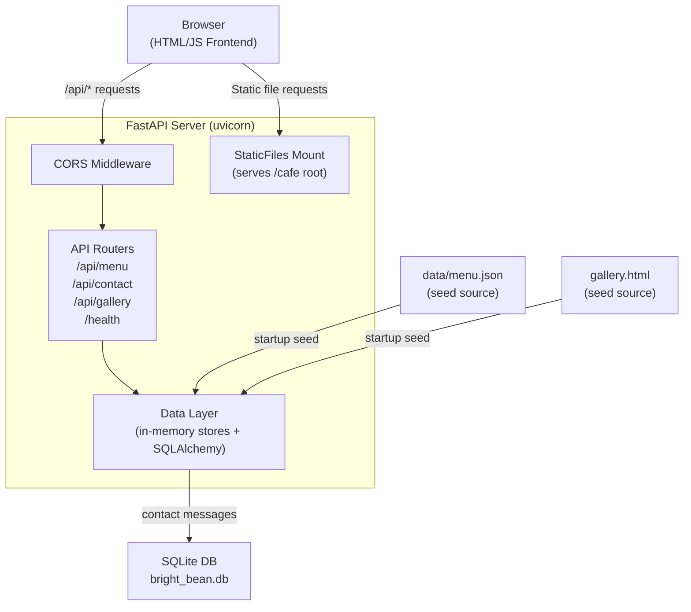

# Design Document — FastAPI Backend for Bright Bean Café

## Overview

This document describes the technical design for a FastAPI backend that replaces the static `data/menu.json` fetch with a proper REST API, handles contact form submissions with persistence, and serves gallery metadata dynamically. The backend lives in a `backend/` subdirectory inside the existing workspace root and coexists with the static frontend: FastAPI's `StaticFiles` mount serves all HTML/CSS/JS/images at the root, while `/api/*` and `/health` routes take precedence.

The design follows the existing project's constraints — Python, SQLite, no external infrastructure, single-server dev setup — and is intentionally minimal. Future extensions (order management, authentication, image upload) can be layered on without structural changes.

---

## Architecture



**Request flow:**
1. Browser sends a request to the uvicorn server.
2. CORS middleware attaches `Access-Control-Allow-Origin` headers.
3. FastAPI's router matches `/api/*` or `/health` routes first.
4. If no route matches, `StaticFiles` resolves the path against the café directory.
5. API handlers delegate to the data layer; responses are serialized by Pydantic v2.

**Key design decisions:**
- **In-memory stores for menu and gallery**: menu items and gallery items are static catalogue data that change infrequently. Seeding them into Python dicts on startup gives sub-millisecond lookups, satisfies the ≤500ms SLA with no database overhead, and avoids migration complexity for this data.
- **SQLite + SQLAlchemy for contacts**: contact messages require durability and ordered retrieval. SQLite is zero-config, file-based, and sufficient for a small café's submission volume. SQLAlchemy provides a clean abstraction and makes swapping to PostgreSQL trivial later.
- **Pydantic v2**: FastAPI's native validation layer; handles all request parsing, response serialisation, field-level constraints, and error messages automatically.
- **Single-file module layout**: the backend is small enough that a flat `backend/` directory with one router per domain is readable without introducing a complex package hierarchy.

---

## Components and Interfaces

### Directory Layout

```
d:\backend\cafe\cafe\
├── backend/
│   ├── main.py               # FastAPI app factory, middleware, startup hooks
│   ├── routers/
│   │   ├── menu.py           # GET /api/menu, GET /api/menu/{id}
│   │   ├── contact.py        # POST /api/contact, GET /api/contact
│   │   ├── gallery.py        # GET /api/gallery
│   │   └── health.py         # GET /health
│   ├── models/
│   │   ├── menu.py           # MenuItem Pydantic model
│   │   ├── contact.py        # ContactMessage Pydantic model + ORM model
│   │   └── gallery.py        # GalleryItem Pydantic model
│   ├── data/
│   │   └── store.py          # In-memory stores (menu, gallery) + seed logic
│   ├── db/
│   │   ├── database.py       # SQLAlchemy engine, SessionLocal, Base
│   │   └── models.py         # ContactMessageORM SQLAlchemy model
│   ├── seeds/
│   │   └── gallery_seed.py   # Static gallery data (mirrored from gallery.html)
│   ├── requirements.txt
│   └── README.md
├── data/
│   └── menu.json             # existing — seed source for menu
├── gallery.html              # existing — gallery data parsed from here
└── ... (all other existing frontend files)
```

### API Endpoints

| Method | Path | Description |
|--------|------|-------------|
| `GET` | `/api/menu` | Return all menu items (optionally filtered by `?category=`) |
| `GET` | `/api/menu/{id}` | Return a single menu item by id |
| `POST` | `/api/contact` | Submit a contact message |
| `GET` | `/api/contact` | Return all contact submissions (newest first) |
| `GET` | `/api/gallery` | Return all gallery items (optionally filtered by `?category=`) |
| `GET` | `/health` | Health check |

### `main.py` — App Factory

```python
# Responsibilities:
# - Create FastAPI app instance
# - Register CORS middleware with localhost + ALLOWED_ORIGINS env var
# - Include all routers with /api prefix
# - Register startup event: seed menu store, seed gallery store, create DB tables
# - Mount StaticFiles at "/" for the cafe frontend directory
# - Register global exception handlers (500, 400, 422)
```

### `routers/menu.py`

```python
# GET /api/menu
#   - Optional query param: category: str = None
#   - Delegates to store.get_menu_items(category)
#   - Returns List[MenuItem]

# GET /api/menu/{id}
#   - Path param: id: int (positive)
#   - Delegates to store.get_menu_item(id)
#   - Raises HTTPException(404) if not found
#   - FastAPI raises 422 automatically for non-integer / non-positive id
```

### `routers/contact.py`

```python
# POST /api/contact
#   - Body: ContactMessage (validated by Pydantic)
#   - Writes to SQLite via SQLAlchemy session
#   - Returns 201 with {message: str, id: int}
#   - On DB error: returns 503

# GET /api/contact
#   - Reads all rows from SQLite ordered by submitted_at DESC
#   - Returns List[ContactMessageResponse]
```

### `routers/gallery.py`

```python
# GET /api/gallery
#   - Optional query param: category: str = None
#   - Delegates to store.get_gallery_items(category)
#   - Returns List[GalleryItem]
```

### `routers/health.py`

```python
# GET /health
#   - Probes SQLite with a simple SELECT 1
#   - Returns {status: "ok", service: "bright-bean-api"} with 200
#   - Returns {status: "degraded", detail: str} with 503 if DB unreachable
```

### `data/store.py` — In-Memory Data Store

```python
# Module-level state:
_menu_items: dict[int, MenuItem] = {}
_gallery_items: dict[int, GalleryItem] = {}

# seed_menu(path: str) -> None
#   - Reads data/menu.json, validates each item against MenuItem model
#   - Populates _menu_items; logs error and raises SystemExit if file missing or invalid JSON

# seed_gallery(items: list[dict]) -> None
#   - Accepts the hardcoded gallery data list (mirrored from gallery.html)
#   - Populates _gallery_items idempotently (clears then refills)

# get_menu_items(category: str | None) -> list[MenuItem]
#   - Returns all items if category is None or "All"
#   - Returns filtered list otherwise (exact case-sensitive match)

# get_menu_item(id: int) -> MenuItem | None

# get_gallery_items(category: str | None) -> list[GalleryItem]
```

---

## Data Models

### MenuItem (Pydantic v2)

```python
class MenuItem(BaseModel):
    id: int                          # unique positive integer
    name: str                        # 1–100 characters
    category: str                    # 1–50 characters
    description: str                 # 0–500 characters
    price: float                     # 0.01–9999.99
    image: str                       # non-empty, max 2048 characters
    featured: bool | None = None     # optional
    tags: list[str] | None = None    # optional; max 20 tags, each max 50 chars

    model_config = ConfigDict(from_attributes=True)
```

### GalleryItem (Pydantic v2)

```python
class GalleryItem(BaseModel):
    id: int           # unique positive integer
    category: str     # non-empty string
    image: str        # non-empty relative URL path
    label: str        # non-empty string
```

### ContactMessage — Request Body (Pydantic v2)

```python
class ContactMessage(BaseModel):
    name: str     # min 2 non-whitespace chars, max 100 chars
    email: EmailStr  # Pydantic's EmailStr; max 254 chars
    subject: str  # min 2 non-whitespace chars, max 150 chars
    message: str  # min 6 non-whitespace chars, max 2000 chars

    @field_validator("name", "subject", "message")
    @classmethod
    def strip_and_validate_not_whitespace(cls, v: str) -> str:
        if not v.strip():
            raise ValueError("Field must contain at least one non-whitespace character")
        return v
```

### ContactMessageORM (SQLAlchemy)

```python
class ContactMessageORM(Base):
    __tablename__ = "contact_messages"

    id           = Column(Integer, primary_key=True, autoincrement=True)
    name         = Column(String(100), nullable=False)
    email        = Column(String(254), nullable=False)
    subject      = Column(String(150), nullable=False)
    message      = Column(Text, nullable=False)
    submitted_at = Column(DateTime, nullable=False, default=datetime.utcnow)
```

### ContactMessageResponse (Pydantic v2)

```python
class ContactMessageResponse(BaseModel):
    id: int
    name: str
    email: str
    subject: str
    message: str
    submitted_at: datetime

    model_config = ConfigDict(from_attributes=True)
```

### Error Response

All error responses share a consistent shape:

```python
class ErrorResponse(BaseModel):
    detail: str
```

FastAPI's built-in `HTTPException` and validation error handlers already produce `{"detail": ...}`, so this is the natural convention.

### Health Response

```python
class HealthResponse(BaseModel):
    status: Literal["ok", "degraded"]
    service: str
    detail: str | None = None   # present only when status == "degraded"
```

### API Response Summary

| Endpoint | Success status | Response body |
|----------|---------------|---------------|
| `GET /api/menu` | 200 | `List[MenuItem]` |
| `GET /api/menu/{id}` | 200 | `MenuItem` |
| `POST /api/contact` | 201 | `{"message": str, "id": int}` |
| `GET /api/contact` | 200 | `List[ContactMessageResponse]` |
| `GET /api/gallery` | 200 | `List[GalleryItem]` |
| `GET /health` | 200 / 503 | `HealthResponse` |

---

## Correctness Properties

*A property is a characteristic or behavior that should hold true across all valid executions of a system — essentially, a formal statement about what the system should do. Properties serve as the bridge between human-readable specifications and machine-verifiable correctness guarantees.*

### Property 1: Category filter completeness — menu

*For any* non-empty list of MenuItems seeded into the store and any category string `C`, `GET /api/menu?category=C` shall return exactly the items whose `category` field equals `C` (case-sensitive exact match), no more and no fewer.

**Validates: Requirements 1.2, 1.7**

### Property 2: MenuItem schema completeness

*For any* MenuItem present in the in-memory store, `GET /api/menu` shall return it with all required fields (`id`, `name`, `category`, `description`, `price`, `image`) present, correctly typed, and within their declared constraints (price in 0.01–9999.99, name ≤ 100 characters, image non-empty).

**Validates: Requirements 1.5**

### Property 3: Single item lookup round-trip

*For any* MenuItem in the store, `GET /api/menu/{id}` shall return a response body that is structurally and value-equal to the item that was seeded with that `id`.

**Validates: Requirements 2.1, 2.2**

### Property 4: Contact submission round-trip

*For any* valid ContactMessage (with randomly generated `name`, `email`, `subject`, and `message` values that satisfy field constraints), submitting it via `POST /api/contact` and then calling `GET /api/contact` shall return a list that includes a record with matching `name`, `email`, `subject`, and `message` values.

**Validates: Requirements 3.1, 3.2**

### Property 5: Contact submission ordering invariant

*For any* sequence of valid ContactMessages submitted in order, `GET /api/contact` shall always return them sorted by `submitted_at` descending — i.e., the most recently submitted message shall appear first.

**Validates: Requirements 3.6**

### Property 6: Whitespace-only fields are rejected

*For any* string composed entirely of whitespace characters (including the empty string), submitting it as the `name`, `subject`, or `message` field of a ContactMessage shall return HTTP 422 and the stored contact count shall remain unchanged.

**Validates: Requirements 3.4, 3.5**

### Property 7: Invalid email addresses are rejected

*For any* string that is not a syntactically valid email address, submitting it as the `email` field of a ContactMessage shall return HTTP 422.

**Validates: Requirements 3.3, 3.5**

### Property 8: Category filter completeness — gallery

*For any* non-empty list of GalleryItems seeded into the store and any category string `C`, `GET /api/gallery?category=C` shall return exactly the items whose `category` field equals `C` (case-sensitive exact match), no more and no fewer.

**Validates: Requirements 4.2, 4.4**

### Property 9: GalleryItem schema completeness

*For any* GalleryItem present in the store, `GET /api/gallery` shall return it with all required fields (`id`, `category`, `image`, `label`) present and non-empty.

**Validates: Requirements 4.5**

### Property 10: Error responses always carry `Content-Type: application/json`

*For any* request to any `/api/*` endpoint that results in a 4xx or 5xx response, the response shall include the header `Content-Type: application/json` and the response body shall contain a `detail` field.

**Validates: Requirements 7.1, 7.2, 7.3, 7.4, 7.5, 7.6**

---

## Error Handling

### Validation Errors (422)

FastAPI raises `RequestValidationError` automatically when Pydantic model validation fails. The default handler returns:

```json
{"detail": [{"loc": [...], "msg": "...", "type": "..."}]}
```

A custom handler wraps this into a flat `{"detail": "..."}` shape to avoid exposing internal model paths.

### Not Found (404)

Routers raise `HTTPException(status_code=404, detail="Menu item not found")` when a requested resource does not exist. Static file 404s are handled by FastAPI's `StaticFiles` mount.

### Internal Server Error (500)

A global exception handler catches any unhandled `Exception`, logs it with `logging.exception`, and returns:

```json
{"detail": "Internal server error"}
```

Stack traces are never forwarded to the response.

### Invalid JSON Body (400)

A custom exception handler catches `json.JSONDecodeError` / `UnicodeDecodeError` raised during body parsing and returns:

```json
{"detail": "Request body is not valid JSON"}
```

### Database Unavailable (503)

Contact submission and health check routes wrap DB operations in a try/except. On `SQLAlchemyError`:
- `POST /api/contact` → 503 `{"detail": "Service temporarily unavailable"}`
- `GET /health` → 503 `{"status": "degraded", "detail": "Database unreachable"}`

### CORS Preflight

CORS middleware (via `fastapi.middleware.cors.CORSMiddleware`) handles `OPTIONS` requests automatically before they reach any route handler.

### Startup Failure

If `data/menu.json` is missing or contains invalid JSON, `seed_menu()` logs an error with full detail and raises `SystemExit(1)` so the server halts with a clear message rather than serving empty data silently.

---

## Testing Strategy

### Libraries

| Purpose | Library |
|---------|---------|
| Test runner | `pytest` |
| HTTP test client | `httpx` + FastAPI's `TestClient` (or `AsyncClient` for async routes) |
| Property-based testing | `hypothesis` (≥ 6.x) |
| Database | In-memory SQLite (`sqlite:///:memory:`) via pytest fixtures |

### Unit Tests

Focus on:
- Field validators in `ContactMessage` (whitespace rejection, email format, length bounds at exact boundaries — min/max values)
- `store.get_menu_items(category)` with known input lists
- `store.get_gallery_items(category)` with known input lists
- `seed_menu()` raising `SystemExit` on missing / malformed JSON
- `seed_gallery()` idempotency (call twice, assert count unchanged)
- Error handler functions in isolation (status codes, response shapes)

### Integration Tests (Example-Based)

- `GET /api/menu` returns all seeded items with status 200
- `GET /api/menu?category=All` returns all items
- `GET /api/menu/{id}` with non-integer id returns 422
- `GET /api/menu/0` and `GET /api/menu/-1` return 422
- `GET /api/menu/9999` (non-existent) returns 404
- `POST /api/contact` with malformed JSON body returns 400
- `GET /api/gallery?category=All` returns all gallery items
- `GET /health` returns 200 with `status: "ok"` and `service: "bright-bean-api"`
- `GET /health` with mocked DB failure returns 503 with `status: "degraded"`
- OPTIONS preflight request returns 200 with CORS headers
- Static file request for `index.html` returns 200 with `Content-Type: text/html`
- Static file request for non-existent path returns 404

### Property-Based Tests (Hypothesis)

Each property test runs a minimum of **100 iterations** via Hypothesis. Each test is tagged with a comment referencing the design property it validates.

```python
# Feature: fastapi-backend, Property 1: Category filter completeness — menu
@given(
    items=st.lists(menu_item_strategy(), min_size=1, max_size=30),
    category=st.text(min_size=1, max_size=50)
)
def test_menu_category_filter(items, category): ...

# Feature: fastapi-backend, Property 2: MenuItem schema completeness
@given(items=st.lists(menu_item_strategy(), min_size=1, max_size=20))
def test_menu_item_schema(items): ...

# Feature: fastapi-backend, Property 3: Single item lookup round-trip
@given(item=menu_item_strategy())
def test_menu_item_lookup_roundtrip(item): ...

# Feature: fastapi-backend, Property 4: Contact submission round-trip
@given(msg=contact_message_strategy())
def test_contact_submission_roundtrip(msg): ...

# Feature: fastapi-backend, Property 5: Contact submission ordering invariant
@given(msgs=st.lists(contact_message_strategy(), min_size=2, max_size=10))
def test_contact_ordering(msgs): ...

# Feature: fastapi-backend, Property 6: Whitespace-only fields are rejected
@given(whitespace=st.text(alphabet=" \t\n\r", min_size=0, max_size=50))
def test_whitespace_fields_rejected(whitespace): ...

# Feature: fastapi-backend, Property 7: Invalid email addresses are rejected
@given(bad_email=st.text().filter(lambda s: "@" not in s or not is_valid_email(s)))
def test_invalid_email_rejected(bad_email): ...

# Feature: fastapi-backend, Property 8: Category filter completeness — gallery
@given(
    items=st.lists(gallery_item_strategy(), min_size=1, max_size=20),
    category=st.text(min_size=1, max_size=50)
)
def test_gallery_category_filter(items, category): ...

# Feature: fastapi-backend, Property 9: GalleryItem schema completeness
@given(items=st.lists(gallery_item_strategy(), min_size=1, max_size=20))
def test_gallery_item_schema(items): ...

# Feature: fastapi-backend, Property 10: Error responses always carry Content-Type: application/json
# (tested against all error-producing endpoints with generated bad inputs)
@given(bad_id=st.integers().filter(lambda x: x <= 0))
def test_error_responses_content_type(bad_id): ...
```

**Hypothesis strategies:**

```python
# menu_item_strategy() generates MenuItem dicts with:
#   - id: positive int
#   - name: text(1–100 chars)
#   - category: sampled_from(known categories) | text(1–50 chars)
#   - description: text(0–500 chars)
#   - price: floats(min_value=0.01, max_value=9999.99)
#   - image: text(1–2048 chars)

# contact_message_strategy() generates ContactMessage dicts with:
#   - name: text(2–100 chars).filter(has_non_whitespace)
#   - email: emails() (Hypothesis email strategy)
#   - subject: text(2–150 chars).filter(has_non_whitespace)
#   - message: text(6–2000 chars).filter(has_non_whitespace)

# gallery_item_strategy() generates GalleryItem dicts with:
#   - id: positive int
#   - category: text(1–50 chars)
#   - image: text(1–200 chars)
#   - label: text(1–200 chars)
```

### Test Database Isolation

Each test that writes to SQLite uses an in-memory database (`sqlite:///:memory:`) scoped to the test via a pytest fixture. The `TestClient` is created with the app's `db` dependency overridden:

```python
@pytest.fixture
def client(tmp_db):
    app.dependency_overrides[get_db] = lambda: tmp_db
    yield TestClient(app)
    app.dependency_overrides.clear()
```

This ensures tests are fully isolated and do not share state.
